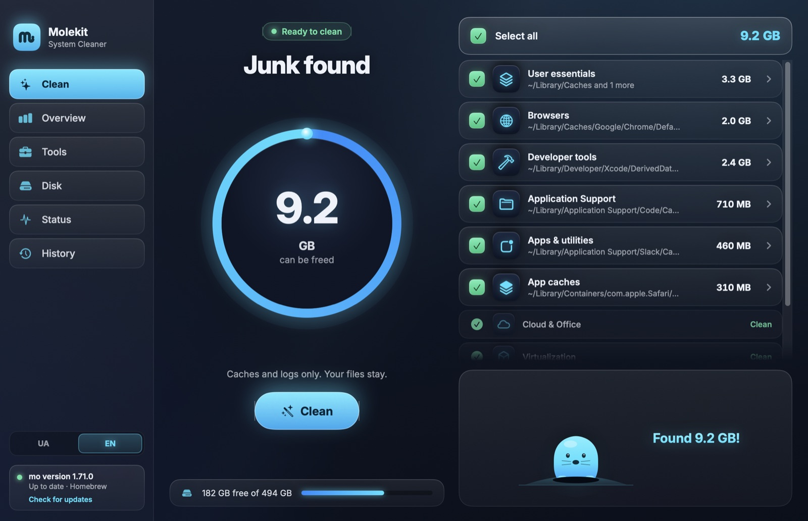
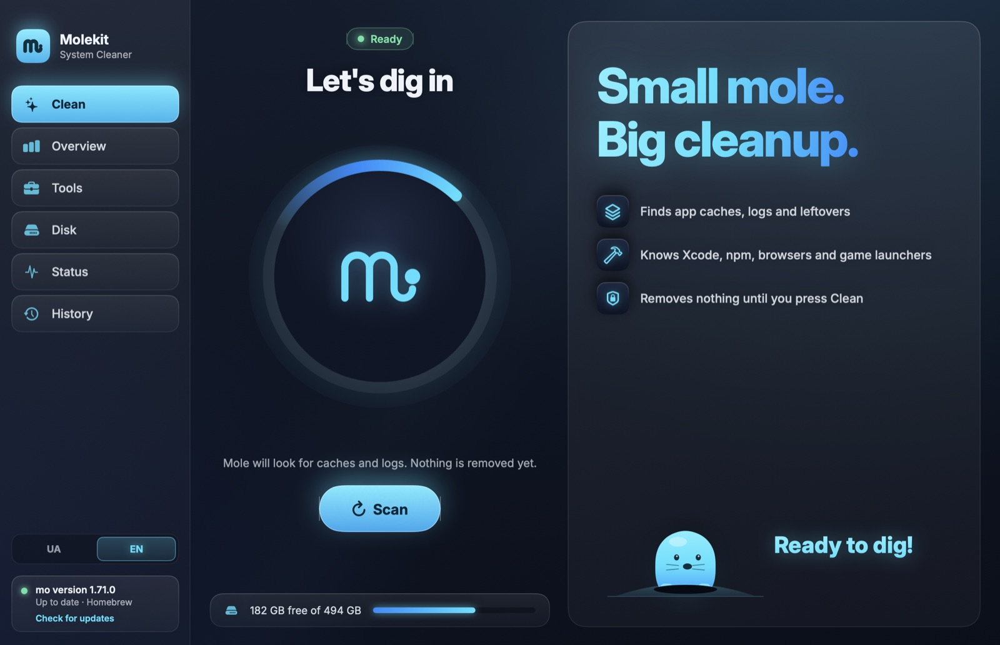
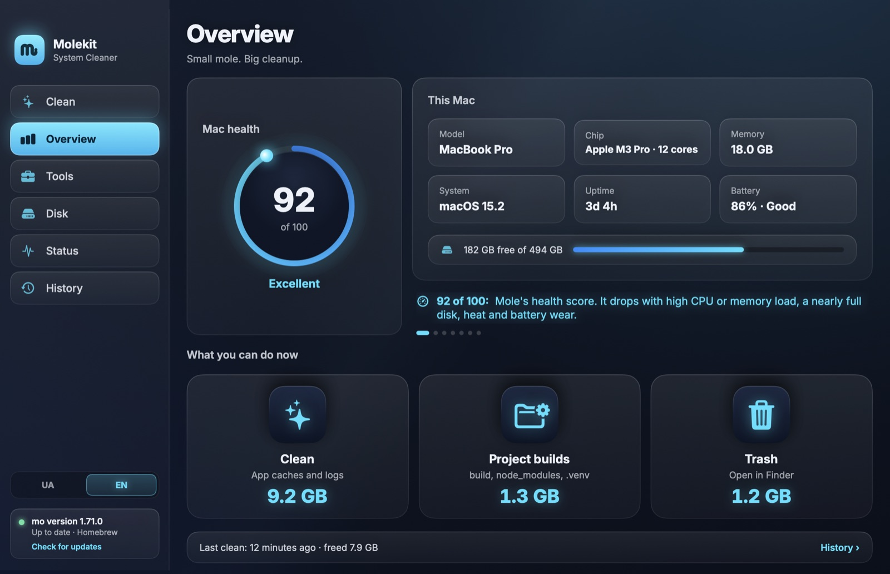
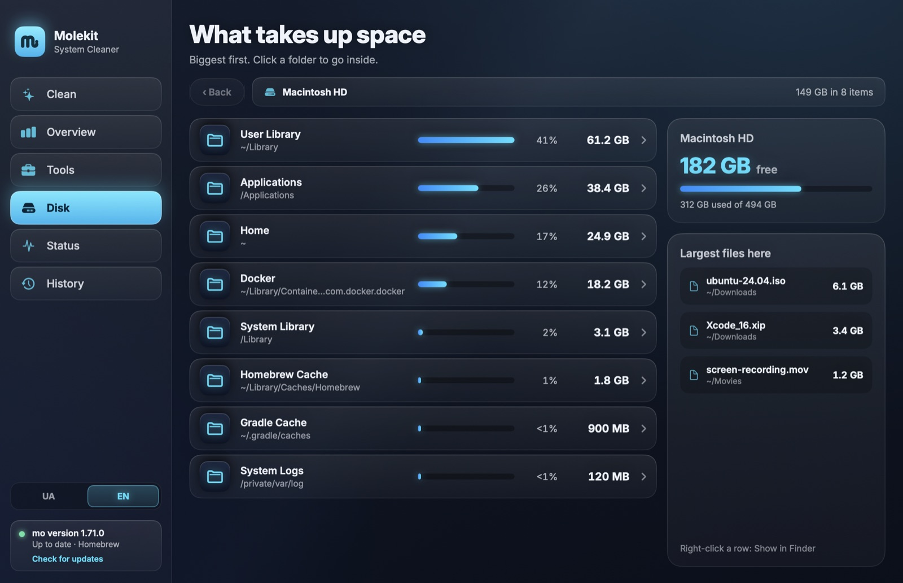
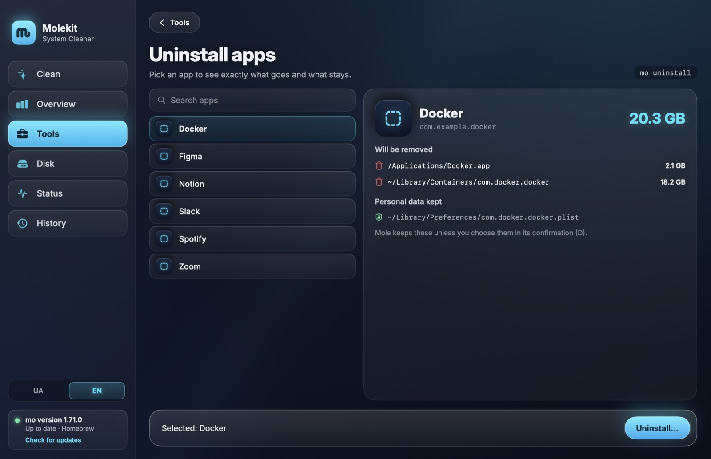

<p align="center">
  
</p>

<h1 align="center">Molekit</h1>

<p align="center"><b>Small mole. Big cleanup.</b><br>
A native macOS window for the <a href="https://github.com/tw93/Mole">Mole</a> (<code>mo</code>) CLI.</p>

<p align="center">
  
</p>

Molekit is a SwiftUI front end for Mole, the open-source Mac cleaner by tw93.
It never decides on its own what to delete: every scan and every cleanup is a `mo` command,
so Mole's own safety rules always apply. Molekit shows what Mole found, lets you untick what
you want to keep, and runs Mole for you.

> Molekit is an independent project. It is not made by, affiliated with, or endorsed by the
> author of Mole or by [mole.fit](https://mole.fit/), the official Mole for Mac app.

## Why Molekit

- **No deletion engine of its own.** Molekit never removes files itself; every cleanup is a `mo`
  command, so all of Mole's protections apply. The one file it writes is Mole's whitelist, and only
  for the categories you untick (see below).
- **Private.** No analytics, no crash reporting, no accounts. The only network request is the
  optional Mole update check.
- **Native and light.** Swift and SwiftUI, no Electron or web view. The mole mascot is drawn in code.
- **Honest about interactive steps.** Where Mole wants your confirmation (uninstall, slim,
  installers), Molekit shows a preview and then hands you a real terminal inside the window,
  instead of faking your answers.
- **Built to survive Mole updates.** JSON fields are optional and text parsing is covered by tests,
  so a new Mole version degrades gracefully instead of crashing the app.

## Features

| Screen | What it does | Mole command |
|---|---|---|
| **Clean** | Scans, shows every category live with its size, lets you untick categories and expand them to the exact folders, then cleans | `mo clean --dry-run`, `mo clean` |
| **Overview** | Mac health score, this Mac at a glance, quick actions, rotating tips | `mo status --json`, `mo history --json` |
| **Tools** | Project build output, app uninstaller, optimize, installer files, Intel code in universal apps | `mo purge`, `mo uninstall`, `mo optimize`, `mo installer`, `mo slim` |
| **Disk** | Folder sizes, biggest first, click to go inside; right-click to show in Finder | `mo analyze --json` |
| **Status** | Live CPU, memory, disk, battery, cores and top processes | `mo status --watch` |
| **History** | Past runs, freed space, errors | `mo history --json` |

More:

- **English and Ukrainian**, switchable in the sidebar.
- **Nothing runs on its own.** Every scan starts with your click.
- **Interactive steps stay interactive.** Uninstall, slim and installer cleanup ask for Mole's own
  confirmation in a terminal built into the window.
- **Mole updates.** The sidebar shows whether a newer Mole is out and can run `mo update`.

<p align="center">
  
  
  
  
</p>

## Requirements

- macOS 14 Sonoma or later
- [Mole](https://github.com/tw93/Mole), installed with [Homebrew](https://brew.sh) (see below)

## Install

### Download

1. Install Mole. It comes through [Homebrew](https://brew.sh), the package manager for macOS.
   If you don't have Homebrew yet, paste this into Terminal (the command from brew.sh):

   ```bash
   /bin/bash -c "$(curl -fsSL https://raw.githubusercontent.com/Homebrew/install/HEAD/install.sh)"
   ```

   Then install Mole:

   ```bash
   brew install mole
   ```

   Other ways to install Mole are in [its README](https://github.com/tw93/Mole).
2. Download `Molekit-<version>.dmg` from [Releases](https://github.com/TrueNihilisme/Molekit/releases/latest),
   open it and drag **Molekit** to **Applications**.
3. Molekit is signed ad-hoc but not notarized by Apple (that needs a paid Apple Developer account),
   so macOS blocks the first launch. Remove the quarantine flag once:

   ```bash
   xattr -dr com.apple.quarantine /Applications/Molekit.app
   ```

The app is universal (Apple silicon and Intel). Each release lists the SHA-256 of its DMG.

### Build from source

```bash
git clone https://github.com/TrueNihilisme/Molekit.git
cd Molekit
./build.sh --install    # builds Molekit.app and copies it to /Applications
```

Needs Xcode or the Xcode command line tools (Swift 6). `./build.sh` without `--install` leaves the
app in `build/`. An app you build yourself is not quarantined, so it opens straight away.

### Full Disk Access

macOS hides some folders (other apps' containers, Mail, Safari data and more) from apps without
Full Disk Access. Mole runs inside Molekit, so without it Mole may find less than it could.
For the full picture: **System Settings → Privacy & Security → Full Disk Access → add Molekit**,
then restart Molekit.

## How unticking works

Mole cleans everything a run finds; it has no per-category switch. When you untick a category,
Molekit adds its folders to Mole's own whitelist (`~/.config/mole/whitelist`) for that one run
and then restores the file exactly as it was. A plain path in the whitelist protects the folder
and everything inside it.

If the Mac loses power or Molekit is killed in the middle of such a run, the extra entries stay in
the whitelist until Molekit starts again and restores it. If you run `mo` in Terminal before that,
open `~/.config/mole/whitelist` and delete the lines below `# Molekit: unticked in the app, temporary`
(or the whole file, if it starts with `# Mole defaults (written by Molekit…`).

## Privacy

- No analytics, no crash reporting, no accounts.
- The only network request Molekit makes itself is the Mole update check, to the same place `mo`
  uses: `formulae.brew.sh` for Homebrew installs, GitHub releases otherwise.
- Everything else is local: Molekit runs `mo` and reads what it prints.

## Building and testing

```bash
swift build                       # debug build
swift test                        # parser and whitelist tests
MOLEKIT_LIVE=1 swift test         # also read-only / --dry-run tests against your real mo
swift Scripts/make-icon.swift     # regenerate the app icon
```

Screenshots in this README are made with demo data: `Molekit --demo-shots <folder>`.

## Credits

- [Mole](https://github.com/tw93/Mole) by tw93 (GPL-3.0) does all the real work.
- [SwiftTerm](https://github.com/migueldeicaza/SwiftTerm) by Miguel de Icaza (MIT) powers the built-in terminal.
- [Inter](https://github.com/rsms/inter) by Rasmus Andersson (SIL OFL 1.1) is the interface font.

## Support

If this project is useful to you, you can support its development with a crypto donation:

| Network | Address |
|---|---|
| Bitcoin (BTC) | `bc1q0sw0w9mqtghrxfyyqw834sjs7t7rr7futulgv4` |
| Ethereum (ETH) | `0xAb3a04a4b52547a7f8B00abb0088D3d9d11CA461` |
| Solana (SOL) | `2QBoKrUaiAcAKxNJ7o9oe9Q16ptjLQohR8KyPX2tpJhZ` |

Send each coin only on the network named in its row: a transfer made on another network cannot be recovered.

## License

[GPL-3.0](LICENSE). The bundled Inter font is under the SIL Open Font License 1.1
(`Sources/Molekit/Resources/Fonts/Inter-LICENSE.txt`).
